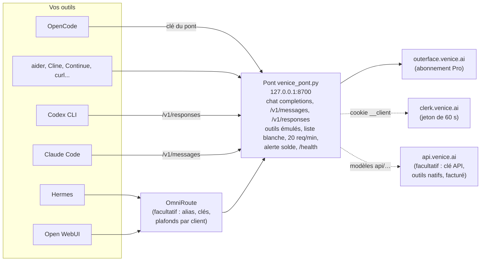

# venice-setup

[](https://github.com/xairon/ve_nice-proxy/actions/workflows/ci.yml)   

Brancher un compte **Venice** (abonnement Pro) sur vos outils d'IA — OpenCode, Hermes, Codex CLI, Claude Code, Open WebUI, OmniRoute, tout client « OpenAI-compatible » — par un petit pont local, en utilisant les modèles « sans pièce » (illimités avec Pro).

> ## ⚠️ À lire avant tout : conditions d'utilisation de Venice
> Ce projet fait utiliser **le cookie de session web** de votre compte par un programme. Les conditions d'utilisation de Venice **interdisent l'usage programmatique** du compte web : l'API officielle (payante à l'usage) est le chemin prévu. **Votre compte peut être suspendu.** Utilisez-le à vos risques, avec un compte dont vous acceptez de risquer l'accès, à faible cadence (le pont plafonne à 20 requêtes par minute par défaut). Les auteurs n'ont aucun lien avec Venice et ne donnent aucune garantie (licence MIT, voir `LICENSE`). Détails : [docs/SECURITE.md](docs/SECURITE.md).

## En bref

```bash
git clone https://github.com/xairon/ve_nice-proxy && cd ve_nice-proxy
./venice-setup quickstart      # cookie > service > état > configuration d'un client
```

Le pont écoute ensuite sur `127.0.0.1:8700` et parle **trois formats** : chat completions d'OpenAI (`/v1/chat/completions`), **Messages d'Anthropic** (`/v1/messages`, pour **Claude Code**) et **Responses d'OpenAI** (`/v1/responses`, pour **Codex CLI**), sans passerelle intermédiaire. Le **tool calling** (lire, écrire, lancer) est **émulé** dans le prompt sur le chemin web, en vrai flux, avec relance corrective ; il est **natif** si vous ajoutez une clé de l'API officielle de Venice → [docs/OUTILS.md](docs/OUTILS.md).

```bash
./venice-setup harness claude-code   # Claude Code directement sur le pont (kimi-k2-5)
./venice-setup harness codex         # Codex CLI directement sur le pont
```

## À quoi ça sert

L'API publique de Venice est facturée à l'usage. L'abonnement Pro donne, **sur le site**, des modèles illimités (ceux qui n'affichent pas de pièce dans le sélecteur). Le pont permet à vos outils de développement d'utiliser ces modèles comme s'ils parlaient à une API OpenAI. Il :

1. fabrique un jeton Clerk de 60 s à partir du cookie `__client` de votre compte (et le renouvelle),
2. parle à `outerface.venice.ai`, le service que le site utilise,
3. expose une API **OpenAI-compatible** locale (`/v1/chat/completions`, `/v1/models`, flux SSE), **Anthropic-compatible** (`/v1/messages`, `/v1/messages/count_tokens`) et **Responses** (`/v1/responses`), avec des **appels d'outils émulés** (les définitions d'outils passent dans le prompt, la réponse — JSON demandé, `<tool_call>` ou objet nu — est transformée en `tool_calls` ; la prose est relayée au fil de l'eau), `tool_choice`, une **garde de contexte** qui remplace la troncature silencieuse de Venice, des **alias** (`claude-*`, `gpt-*` → `kimi-k2-5`), et le **multimodal** : vision, PDF et **OCR**, audio, génération et édition d'images, voix, embeddings, recherche web ([docs/MULTIMODAL.md](docs/MULTIMODAL.md)),
4. **refuse** les modèles payants (HTTP 403), plafonne le débit, et surveille votre solde de crédits ;
5. facultatif : avec une **clé de l'API officielle** (`VENICE_API_KEY`), sert aussi les modèles `api/<id>` par `api.venice.ai` (chemin conforme aux CGU, **facturé à l'usage**), avec tool calling **natif** quand le modèle le permet. Sans cookie, le pont tourne en mode « API seule ».

## Architecture



Version texte :

```
 OpenCode / aider / curl / Claude Code / Codex ───┐
 Hermes / Open WebUI ───────────────────────► OmniRoute (facultatif) ─► pont 127.0.0.1:8700 ─► outerface.venice.ai
                                              alias, clés, plafonds     liste blanche, 20 req/min,   (jeton Clerk miné depuis
                                                                         alerte solde, /health        le cookie __client)
```

Deux chemins existent côté Venice, que le pont choisit selon le modèle :

| Route Venice | Modèles | Contexte utile |
|---|---|---|
| Chat classique | Qwen 3.8 27B, Venice Uncensored 1.2, Gemma 4 Uncensored, GLM 4.7 Heretic, Role Play, Aion 3.0 | **~39 000 jetons** (au-delà : début tronqué en silence) |
| « Agents » | DeepSeek V4.1 Flash Uncensored, Kimi K2.5 | 524 288 (DeepSeek) ou 262 144 (Kimi), dont ~15 000 de prompt imposé par Venice |

## Prérequis

- **Python 3.9 ou plus**, **aucune dépendance** (bibliothèque standard seule).
- Pour tourner en service : Linux avec **systemd utilisateur**, ou **Docker** (`docker-compose.yml`). Ailleurs (macOS, Windows, essai rapide) : `python3 venice-setup run` au premier plan.
- Un **compte Venice Pro** et son cookie `__client` ([docs/COOKIE.md](docs/COOKIE.md)).
- Facultatif : OmniRoute (passerelle de modèles) pour des alias et des clés par client.
- Facultatif : une clé de l'API officielle de Venice (`VENICE_API_KEY` dans le fichier de secrets) pour les modèles `api/…`.

## Démarrage rapide

```bash
git clone https://github.com/xairon/ve_nice-proxy && cd ve_nice-proxy
python3 venice-setup quickstart      # login (cookie en saisie masquée) > service > état > configuration d'un client
```

`quickstart` enchaîne les quatre étapes (il accepte `--cookie-fichier`, `--dry-run`, `--harnais opencode --appliquer`). Étape par étape :

```bash
python3 venice-setup login                          # guide + saisie masquée du cookie __client, validation, écriture en 600
python3 venice-setup install                        # service systemd utilisateur (--dry-run pour voir sans rien faire)
python3 venice-setup run                            # ... ou : pont au premier plan, sans systemd (macOS, Windows, essai)
python3 venice-setup status                         # santé du pont, cookie, crédits
python3 venice-setup harness opencode --appliquer   # ajoute le fournisseur dans opencode.json (sauvegarde .bak-*)
```

**Docker** (après `login`) : `docker compose up -d --build`, puis `curl -s http://127.0.0.1:8700/health`. Le conteneur ne publie que sur `127.0.0.1`.

**Sans OmniRoute** : le pont suffit à OpenCode, aider, Continue, Cline, curl, tout client OpenAI-compatible, et désormais **Claude Code** (`/v1/messages`) et **Codex CLI** (`/v1/responses`). OmniRoute ne sert plus qu'à mettre des alias, des clés et des plafonds par client.

Windows : les tests du pont passent sur le runner Windows de la CI (28/10/2026), mais l'auteur n'a pas de machine Windows : `python venice-setup run` au premier plan est le chemin à tenter, un retour est le bienvenu.

## Documentation

| Document | Contenu |
|---|---|
| [docs/INSTALL.md](docs/INSTALL.md) | Installation pas à pas, plusieurs comptes, désinstallation |
| [docs/COOKIE.md](docs/COOKIE.md) | Récupérer le cookie `__client` (Chrome, Firefox), durée de vie, renouvellement |
| [docs/MODELES.md](docs/MODELES.md) | Modèles gratuits (sans pièce) et payants, contextes mesurés, lequel choisir |
| [docs/OUTILS.md](docs/OUTILS.md) | Agents de code : tool calling émulé ou natif, formats d'appel reconnus, `tool_choice`, flux, garde de contexte, alias, API officielle |
| [docs/HARNESS.md](docs/HARNESS.md) | Chaque client : état **testé / non testé**, configuration exacte |
| [docs/OMNIROUTE.md](docs/OMNIROUTE.md) | Alias, clients, bogue du masqueur de secrets (3.8.52) et réglage |
| [docs/SECURITE.md](docs/SECURITE.md) | Risque CGU, plafonds, liste blanche, alerte solde, où vivent les secrets |
| [docs/DEPANNAGE.md](docs/DEPANNAGE.md) | 401, 403, 429, 503, cookie expiré, contexte tronqué, doublons, mémoire… |
| [docs/MULTIMODAL.md](docs/MULTIMODAL.md) | Images en entrée et en sortie, fichiers, voix : routes, formats, coûts mesurés |
| [docs/LIMITES.md](docs/LIMITES.md) | Ce qui n'est **pas** pris en charge |
| [docs/EXEMPLE.md](docs/EXEMPLE.md) | Exemple de bout en bout |
| [pont/ROUTES.md](pont/ROUTES.md) | Routes Venice relevées et champs de requête |
| [pont/bench-2026-10-28.md](pont/bench-2026-10-28.md) | Banc de mesures du 28/10/2026 |
| [CONTRIBUER.md](CONTRIBUER.md) · [CHANGELOG.md](CHANGELOG.md) | Contribuer, historique |

## Commandes

| Commande | Rôle |
|---|---|
| `login [--profil P] [--cookie-fichier F] [--dry-run]` | enregistre le cookie, valide auprès de Clerk (aucun appel payant) |
| `install [--profil P] [--dry-run]` | écrit l'unité systemd utilisateur et la démarre |
| `uninstall [--profil P] [--purger] [--dry-run]` | retire le service ; `--purger` efface aussi cookie et clé |
| `status [--profil P]` | santé, jours restants du cookie, crédits, débit détecté (code retour 1 si problème) |
| `models [--pont]` | modèles sans pièce / payants ; `--pont` liste ce que sert votre pont |
| `harness NOM [--modele M] [--appliquer]` | configuration pour un client (`opencode`, `openai`, `omniroute`, `hermes`, `openwebui`, `aider`, `cline`, `continue`, `codex`, `claude-code`) |
| `profils` | liste les profils (un profil = un compte = un pont) |

Tests : `python -m pytest tests pont/tests` (263 tests, aucun appel réseau).

## Ce qui n'est pas pris en charge

Génération vidéo ou musique, édition d'image, audio ou vidéo en entrée d'un modèle, personnages, mémoire Venice : voir [docs/LIMITES.md](docs/LIMITES.md). Le **multimodal** (vision, fichiers, génération d'images, synthèse et transcription vocales) fonctionne : voir [docs/MULTIMODAL.md](docs/MULTIMODAL.md). Le **tool calling natif** n'est pas exposé par le chemin web : les outils sont émulés, avec une relance corrective si le modèle appelle un outil natif de Venice ; il est natif sur l'API officielle (`api/…`, clé API, facturé) ([docs/OUTILS.md](docs/OUTILS.md)).

## Arborescence

```
venice-setup          CLI (Python, bibliothèque standard seule)
pont/                 le pont (venice_pont.py), les traductions Anthropic et Responses (formats.py), tests, ROUTES.md, bancs
gabarits/             unité systemd, env.example, gabarits OmniRoute
docs/                 la documentation
tests/                tests du CLI
```

Aucun secret dans ce dépôt : cookie, clé du pont et clé API éventuelle vivent dans `~/.config/venice-setup/<profil>/venice.env` (mode 600, dossier 700). Licence : MIT.
